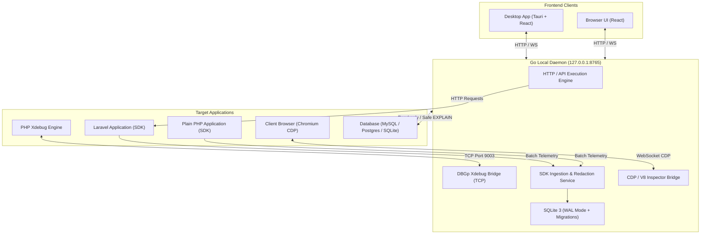

# PHP Debug Studio

<div align="center">


**Complete Software Requirements Specification & Technical Architecture**  
*Free • Open Source • MIT License • Desktop + Browser + Composer SDK*  
*Created and maintained by **zoventra***

</div>

---

## 📖 Executive Summary

**PHP Debug Studio** is a local-first developer workstation and browser application that unifies PHP/Laravel debugging, API authoring/testing, SQL performance analysis, profiling, automated testing, webhook inspection, frontend JavaScript debugging, and observability into a single developer cockpit.

The entire core operates **100% offline**, without mandatory account registration, tracking, or cloud infrastructure. All core modules are released under the permissive **MIT License** with no feature gates or proprietary paywalls.

---

## 🚀 Key Highlights

- ⚡ **Offline-First & Local-Only**: Operates entirely on loopback (`127.0.0.1`). No cloud logins, no mandatory telemetry, and zero vendor lock-in.
- 🔌 **Unified Workstation**: Seamlessly step from an API request to an Xdebug breakpoint, Eloquent SQL query, queued worker job, and frontend browser event.
- 🛠️ **Deep Laravel & Plain PHP Support**: Automatic detection of Laravel routes, middleware, Eloquent queries, cache hits/misses, and jobs via a dedicated lightweight Composer SDK.
- 🐞 **DBGp Step Debugging**: Outbound Xdebug 3.x bridge with path mapping for Docker, Lima, and local environments.
- 🌐 **Modern API Studio**: Full support for REST, GraphQL, WebSocket, SSE, and gRPC with Postman/OpenAPI import and CI collection runner.
- 🪝 **Webhook Studio**: Local receiver, signature verification (HMAC SHA-256), payload inspection, fault simulation, and selective request replay.
- 🖥️ **JavaScript Debug Studio**: Chrome DevTools Protocol (CDP) and Node.js V8 inspector integration for correlating frontend browser clicks with backend PHP traces.
- 🗄️ **Database Solution Advisor**: Evidence-backed SQL diagnostics, automated N+1 query detection, EXPLAIN plan visualizer, and candidate index advice.
- 📂 **Multi-Project Workspace**: Unlimited project and environment switching with strict credential isolation and cross-project trace linking.
- 🤖 **Optional Local AI**: Integration with local Ollama models for error explanation and patch recommendations; completely offline with strict redaction.

---

## 🏛️ System Architecture

PHP Debug Studio separates runtime instrumentation from UI execution using a high-performance Go local daemon and an embedded SQLite event store.



---

## 🧩 26 Core Product Modules

| # | Module | Description |
|---|---|---|
| **01** | **Workspace & Projects** | Centralized project directory, runtime detection, SDK handshake, and debug profiles. |
| **02** | **API Studio** | Comprehensive request authoring, response inspection, history, and variable resolution. |
| **03** | **REST/HTTP Engine** | High-performance HTTP client supporting HTTP/1.1 & HTTP/2, redirects, and cookie jars. |
| **04** | **Authentication** | Bearer, Basic, API Key, and OAuth2 (Authorization Code + PKCE / Client Credentials). |
| **05** | **GraphQL Studio** | Query/mutation composer, schema introspection, variables editor, and fragment support. |
| **06** | **WebSocket & SSE** | Live frame inspector, bi-directional messaging, reconnect, and event stream timelines. |
| **07** | **gRPC Studio** | Protobuf descriptor loading, unary and streaming RPC calls, and metadata editing. |
| **08** | **Collections & Runner** | Automated test runner with pre/post scripts, assertions, iterations, and JUnit exports. |
| **09** | **Mocks & Contracts** | Local loopback mock server matching routes, headers, and statuses against OpenAPI contracts. |
| **10** | **PHP Breakpoint Debugger** | Interactive DBGp step debugging (step into/over/out, call stack, watches, and variable inspection). |
| **11** | **Laravel Inspector** | Deep visibility into routes, controllers, middleware, Eloquent, cache, events, and jobs. |
| **12** | **Exceptions & Error Studio** | Error normalization, stack trace analysis, issue fingerprinting, and breadcrumbs. |
| **13** | **SQL Studio** | Query timeline, execution plan analysis, duration tracking, and duplicate query grouping. |
| **14** | **Performance & Memory** | Request waterfall timeline, flamegraphs, memory tracking, and baseline comparison. |
| **15** | **Queues & Scheduler** | Queue job lifecycle tracking, failure grouping, payload inspection, and authorized retries. |
| **16** | **Logs & Correlation** | Structured log explorer linked to corresponding requests, queries, and trace IDs. |
| **17** | **Test Studio** | PHPUnit and Pest test runner integration with output streaming and code coverage links. |
| **18** | **CLI & Artisan** | Safe Artisan command runner with allowlists, argument validation, and terminal audit logs. |
| **19** | **Security Diagnostics** | Local configuration auditing, secret leak detection, and vulnerable dependency scans. |
| **20** | **Local AI Assistant** | Offline Ollama integration for diagnosing errors and suggesting patches without data leakage. |
| **21** | **Settings & Extensions** | Plugin capabilities, data retention policies, secret vaults, and import/export controls. |
| **22** | **Webhook Studio** | Incoming local webhook receiver, signature verification, simulation, and replay builder. |
| **23** | **JavaScript Debug Studio** | Browser console capture, DOM inspections, source map mapping, and full-stack trace correlation. |
| **24** | **Database Solution Advisor** | Slow query heuristics, automated N+1 detection, execution plan review, and index advisor. |
| **25** | **Multi-Project Workspaces** | Centralized project and environment management with strict data isolation. |
| **26** | **Global System Contracts** | Standardized error envelopes, W3C traceparent propagation, and security audit logging. |

---

## 📦 Monorepo Layout

```text
php-debug-studio/
├── apps/
│   ├── desktop/              # Tauri desktop shell
│   ├── web/                  # Shared React / TypeScript web UI
│   └── daemon/               # Go local daemon API & execution engine
├── packages/
│   ├── php-core/             # Framework-neutral Composer SDK
│   ├── laravel-adapter/      # Laravel service provider & middleware
│   ├── php-legacy/           # Compatibility adapter for PHP 7.4 - 8.1
│   ├── shared-types/         # Protocol schemas and TypeScript definitions
│   ├── ui/                   # Shared React component library
│   └── cli/                  # Headless collection runner for CI/CD
├── plugins/
│   └── ollama/               # Local LLM integration plugin
├── integrations/
│   └── xdebug-bridge/        # DBGp TCP listener & framing engine
├── docs/
│   ├── architecture/         # Technical architecture specifications & SQLite schema
│   ├── srs/                  # Complete Software Requirements Specification
│   └── api/                  # Local Daemon API documentation
├── examples/
│   ├── laravel/              # Sample Laravel test application
│   └── plain-php/            # Standalone PHP integration example
├── tests/
│   ├── e2e/                  # End-to-end integration test suites
│   └── compatibility/        # Version compatibility matrix fixtures
├── LICENSE                   # MIT License
├── CONTRIBUTING.md           # Contribution guidelines
├── CODE_OF_CONDUCT.md        # Code of conduct
└── SECURITY.md               # Security and vulnerability disclosure policy
```

---

## 🚀 Getting Started

### 1. Install the Laravel Composer SDK

In your Laravel project root:

```bash
composer require --dev zoventra/php-debug-studio-laravel
```

Run the automated installer to publish configuration and verify daemon connectivity:

```bash
php artisan debug-studio:install
php artisan debug-studio:doctor
```

### 2. Standalone PHP Integration

For non-Laravel applications, include the core SDK in your bootstrap sequence:

```php
use Zoventra\DebugStudio\DebugStudio;

require_once __DIR__ . '/vendor/autoload.php';

DebugStudio::init([
    'endpoint'   => 'http://127.0.0.1:8765',
    'project_id' => 'your-project-uuid',
    'collectors' => [
        'errors'   => true,
        'requests' => true,
        'sql'      => true,
    ],
]);
```

### 3. Start the Local Daemon & Desktop App

```bash
# Build and run the local Go daemon
cd apps/daemon && go run main.go

# In another terminal, start the Tauri desktop app
cd apps/desktop && pnpm tauri dev
```

Alternatively, open `http://127.0.0.1:8765` in any modern web browser to access the Web UI without installing the desktop build.

---

## 🔒 Security & Privacy by Design

- **Loopback Default**: Daemon binds strictly to `127.0.0.1`. Remote management requires explicit TLS tunnel configuration.
- **Zero Plaintext Secrets**: OAuth tokens and API credentials are encrypted at rest using the OS Keychain or AES-GCM local vaults.
- **Automated PII Redaction**: Headers such as `Authorization`, `Cookie`, and `Set-Cookie`, as well as passwords and sensitive database bindings, are redacted prior to storage.
- **Safe Database Defaults**: SQL console defaults to **read-only** mode. Destructive actions (`UPDATE`, `DELETE`, `DROP`) require explicit confirmation.
- **Isolated AI Diagnostics**: Local AI prompts are scrubbed and sanitized before inference. Code patches are never auto-applied without manual review.

---

## 🗺️ Engineering Milestones

- [x] **M0: Foundation** — Architecture baseline, SQLite schemas, threat model, CI configuration, and repository layout.
- [ ] **M1: API Core** — REST engine, collection manager, environment variables, and request history.
- [ ] **M2: SDK & Laravel** — PHP error handlers, DB::listen spans, trace correlation, and batch ingestion.
- [ ] **M3: Xdebug Bridge** — DBGp protocol engine, breakpoint management, stack inspection, and path mapping.
- [ ] **M4: Advanced Protocols** — OAuth2 PKCE, WebSocket/SSE streams, OpenAPI contracts, and mocks.
- [ ] **M5: Diagnostics** — SQL advisor, N+1 detection, queue tracking, and log explorer.
- [ ] **M6: Full-Stack & Webhooks** — Webhook Studio (M22), JS Studio (M23), and Database Advisor (M24).
- [ ] **M7: v1.0 Stable Release** — Cross-platform Tauri installers, documentation, and certified test suites.

---

## 🤝 Contributing

We welcome community contributions, bug reports, and design feedback! Please review our [Contribution Guidelines](CONTRIBUTING.md) and [Code of Conduct](CODE_OF_CONDUCT.md).

---

## 📄 License

PHP Debug Studio is open-source software licensed under the **[MIT License](LICENSE)**.  
Copyright © 2026 **zoventra**.
