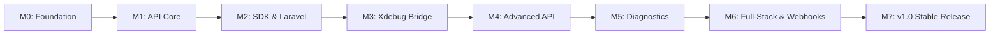

# PHP Debug Studio — Product Roadmap & Milestones

**Maintained by zoventra**  
*Architecture Baseline: Version 1.0 | 22 October 2026*

---

## 🗺️ Milestone Tracking

---

### ✅ Milestone 0: Architecture & Foundation (Completed)
- [x] Comprehensive Software Requirements Specification (SRS) for 26 product modules.
- [x] System architecture, loopback security model, and threat boundaries.
- [x] SQLite schema design with WAL mode, UUID keys, and foreign keys.
- [x] Monorepo structure setup: Go daemon, TypeScript types, PHP Core SDK, Laravel adapter, React Web UI, and Tauri desktop shell.
- [x] MIT licensing and open-source governance documents (`CONTRIBUTING.md`, `CODE_OF_CONDUCT.md`, `SECURITY.md`).

---

### ⏳ Milestone 1: API Core & Execution Engine (In Progress)
- [x] HTTP request execution engine with DNS/TCP/TLS/TTFB timing capture.
- [x] Collection runner CLI (`packages/cli`) with variable interpolation.
- [x] JUnit XML and JSON report generation for CI/CD pipelines.
- [ ] Postman Collection v2.1 & OpenAPI 3.x import/export parser.
- [ ] Cookie jar management and automated redirect policies.

---

### ⏳ Milestone 2: Modern PHP SDK & Laravel Integration
- [x] Core PHP interfaces (`CollectorInterface`, `TransportInterface`, `SanitizerInterface`).
- [x] Automatic error, exception, and shutdown fatal-error hooks.
- [x] W3C `traceparent` propagation and active span tracking.
- [x] Laravel service provider with `DB::listen` query tracing and queue failure listeners.
- [x] Artisan commands: `php artisan debug-studio:install` and `php artisan debug-studio:doctor`.
- [ ] PSR-3 Logger bridge and PSR-15 middleware adapter for standalone PHP frameworks (Symfony, Slim).

---

### ⏳ Milestone 3: DBGp Xdebug Bridge
- [x] TCP listener on `127.0.0.1:9003` with length-prefixed DBGp wire framing.
- [x] Docker/remote container to host workspace path mapping engine (`pathmap.go`).
- [x] Feature negotiation for `max_depth` and `max_children`.
- [ ] Interactive UI breakpoint management, watch expressions, and call stack tree.

---

### ⏳ Milestone 4: Advanced Protocols & Mocks
- [ ] OAuth2 PKCE and Client Credentials authorization flow with encrypted local token vault.
- [ ] WebSocket frame timeline and SSE event stream viewer.
- [ ] GraphQL query composer with schema introspection and variable editor.
- [ ] Local mock server matching routes, query params, and schemas from OpenAPI.

---

### ⏳ Milestone 5: Diagnostics & Solution Advisor
- [x] N+1 query heuristic detection and query fingerprinting.
- [ ] Safe `EXPLAIN` query visualizer for MySQL, PostgreSQL, and SQLite.
- [ ] Performance flamegraphs and sampled memory allocation graphs.
- [ ] Queue job history with replay safeguards.

---

### ⏳ Milestone 6: Webhooks & Full-Stack Browser Debugging
- [x] Webhook Studio: Local receiver endpoints (`/wh/{id}`) and HMAC SHA-256 signature verification.
- [x] Browser CDP / Node.js V8 inspector session tracking.
- [x] Full-stack trace linking correlating frontend clicks to Laravel backend spans.
- [x] Offline local AI assistant plugin using Ollama (`plugins/ollama`).

---

### ⏳ Milestone 7: v1.0 Stable Distribution & Certified Packaging
- [ ] Cross-platform signed installer binaries for macOS (dmg/tar.gz), Linux (AppImage/deb), and Windows (msi).
- [ ] Automated compatibility test matrix verifying PHP 8.2, 8.3, 8.4 and Laravel 10, 11, 12.
- [ ] WCAG 2.1 AA accessibility audit (keyboard navigation, high-contrast themes).
